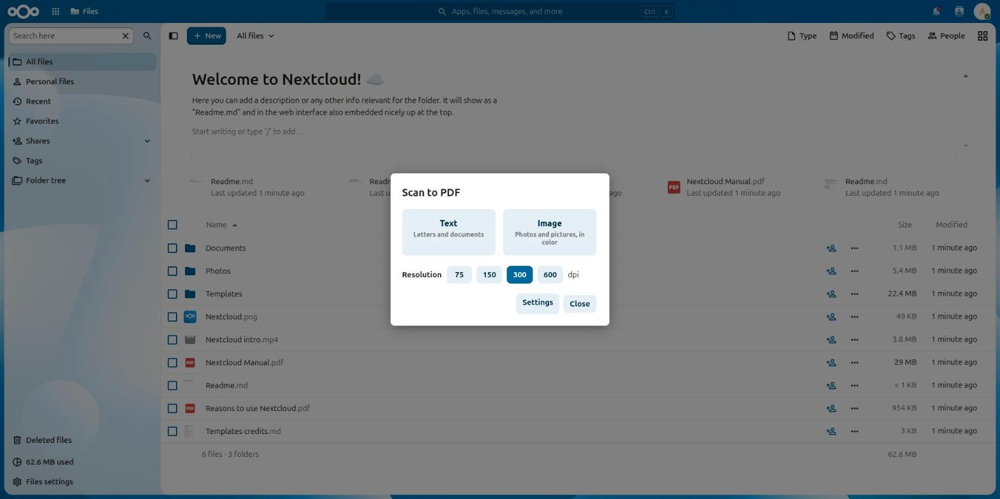
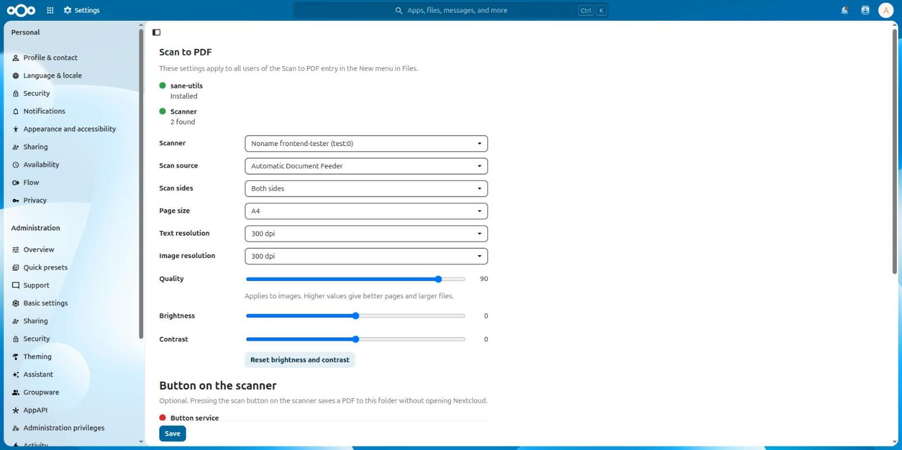

# Scan to PDF

A Nextcloud app that adds **Scan to PDF** to the **New** menu in Files. Choose text or image and the resolution, and the finished PDF lands in the folder you are in.





## Features

- Scans from any scanner [SANE](http://www.sane-project.org/) can reach, connected locally or over the network
- Multi-page PDFs from document feeders, single or double sided
- Text is stored losslessly with 8 shades of gray: sharp, small files and no noise around the letters
- Images are stored as JPEG with adjustable quality
- Global settings for resolution, page size, brightness and contrast
- Removes the dark line many sheet-fed scanners leave at the end of the paper
- Where the driver supports it: straighten pages and remove blank pages
- Optional: start a scan with the button on the scanner, press once for text and twice for image
- A list of the latest scans with error messages for admins

## Requirements

- Nextcloud 33 to 36
- `sane-utils` on the server: `sudo apt install sane-utils`
- The web server user needs access to the scanner. `scanimage -L` run as that user has to list it

**Settings > Administration > Scan to PDF** shows with green and red dots whether everything is in place.

## Button on the scanner

Optional, for scanners whose SANE driver reports a button. Run this once as root on the server, the settings page shows the exact path:

```
sudo sh /path/to/nextcloud/apps/scantopdf/scripts/setup-button.sh
```

It installs and configures `scanbd`, adds a sudo rule limited to the three commands it needs, and in containers a small service that restarts `scanbd` when the scanner reappears. Then enable the button in the settings and choose who receives the scans and where they go.

Tested on Debian with a Fujitsu ScanSnap S1500. Other systems may need manual setup.

## Development

The app has no build step: plain PHP and JavaScript. Without hardware, the SANE `test` backend works: enable `test` in `/etc/sane.d/dll.conf`.

## License

AGPL-3.0-or-later
